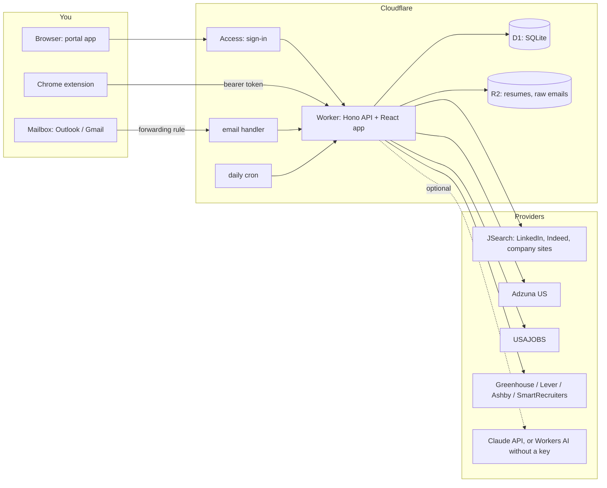
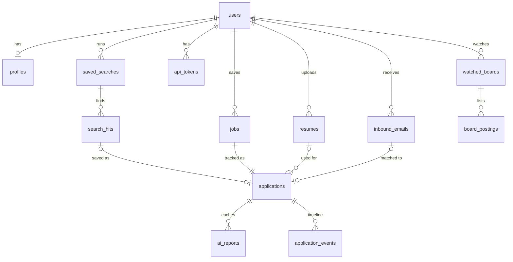
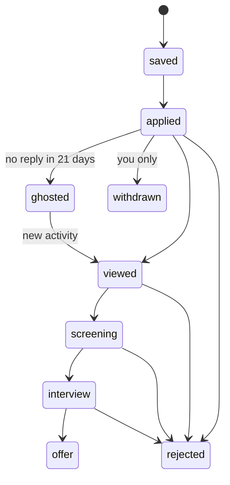

# Architecture

## What it does

A personal portal for a US-focused job search:

1. **Find** fitting jobs from your resume: saved searches (tracks) drafted by AI from a resume, run across
   LinkedIn, Indeed and company sites (via the JSearch aggregator of Google for Jobs), Adzuna US, USAJOBS and
   watched company boards; deduped across sites, flagged for sponsorship/clearance language, ranked by a
   resume-fit score, refreshed daily with "new since yesterday".
2. **Apply** with assisted apply: a browser extension saves any posting in one click (with its fit score) and
   autofills company application forms (Greenhouse, Lever, Ashby) from a full profile (work history,
   education, saved answers) for you to review and submit; AI drafts answers to open questions.
3. **Track** every application's status automatically: forwarded application emails (LinkedIn, Indeed, ATS
   confirmations, rejections, interview invites) move each application through the pipeline; interviews land
   in a private calendar feed; follow-ups come due on the dashboard.
4. **Keep the record**: immutable resume versions linked to each application, full timeline, CSV export.

## Hard constraints

| Constraint                                                                                                                                             | Consequence                                                                                                                                                                                                 |
| ------------------------------------------------------------------------------------------------------------------------------------------------------ | ----------------------------------------------------------------------------------------------------------------------------------------------------------------------------------------------------------- |
| LinkedIn and Indeed have no job-seeker APIs for applying, searching or reading status; their terms forbid bots and scraping (accounts get restricted). | No server-side access to either site. Search uses an aggregator plus pre-filled search links; applying is user-driven; status comes from emails. See [ADR 0002](adr/0002-assisted-apply-not-automation.md). |
| Company ATSs publish official, public job-board APIs (Greenhouse, Lever, Ashby, SmartRecruiters).                                                      | Used for discovery, "watch this company", and URL prefill.                                                                                                                                                  |
| Application emails are the one signal every platform sends.                                                                                            | Email forwarding is the status backbone. See [ADR 0003](adr/0003-email-forwarding-for-status.md).                                                                                                           |
| Personal use, near-zero budget.                                                                                                                        | One serverless Worker on Cloudflare's free tier. See [ADR 0001](adr/0001-single-cloudflare-worker.md).                                                                                                      |

## System

One Worker, three entry points:

| Entry point | Trigger                                              | Does                                                                              |
| ----------- | ---------------------------------------------------- | --------------------------------------------------------------------------------- |
| `fetch`     | HTTP                                                 | `/api/*` REST API (Hono); everything else serves the React app from static assets |
| `email`     | Cloudflare Email Routing (`jobs-xxxx@jobs.<domain>`) | Parse, classify, match, update status                                             |
| `scheduled` | Cron, daily 11:00 UTC                                | Sync watched boards, mark long-silent applications "No response"                  |

## Code layout

| Package                 | Responsibility                                                                                                              | Depends on         |
| ----------------------- | --------------------------------------------------------------------------------------------------------------------------- | ------------------ |
| `packages/core`         | Enums, Zod request schemas, response types, status engine                                                                   | zod                |
| `packages/integrations` | Pure logic: URL canonicalisation, email classification, matching, CSV import, board/search clients, fit scoring, deep links | core               |
| `apps/portal` (worker)  | API routes, services, D1 via Drizzle, R2, email + cron handlers, AI calls                                                   | core, integrations |
| `apps/portal` (client)  | React 19 SPA: dashboard, pipeline, applications, Job Match, inbox, resumes, settings                                        | core               |
| `apps/extension`        | MV3 extension: clipper, fit badge, ATS autofill                                                                             | core, integrations |

`integrations` has no I/O of its own: clients take an injectable `fetch`, so the same code runs in the Worker,
the extension and tests.

## Data model

- `jobs` holds the posting; `applications` holds your progress (1:1). Status `saved` is the wishlist.
- Dedupe: `jobs.url_key` (canonical URL) and `(source, external_id)` are unique per user.
- Matching: `jobs.company_key` is the normalised company name used to match emails.
- Every user-owned row has `user_id`; every query is scoped by it.

## Status engine

`decideTransition(current, proposed, source)` in `packages/core/src/status.ts` is the only way status changes.

- Manual changes always apply.
- Automation (email, import, extension, cron) only moves forward, never leaves `offer`, `rejected` or
  `withdrawn`, and never sets `withdrawn`.
- A rejection applies from any non-final status. `ghosted` is set only by the cron and only for active
  applications; any later activity revives it.

## Key flows

**Job Match.** Resume → (Claude) draft search profile → you edit → `POST /api/match` plans up to N
title x location queries → parallel calls to configured providers → merge and dedupe by URL → `scoreJobFit`
→ optional AI re-rank of the top 20 → ranked list plus pre-filled LinkedIn/Indeed/Google Jobs links.

**Assisted apply.** Open a posting → extension popup extracts it (schema.org JobPosting JSON-LD, site
adapters as fallback), shows the fit score → Save or Save & mark applied (with the resume used). On Greenhouse,
Lever and Ashby forms, "Autofill" fills contact fields and attaches the resume; you review and submit. EEO and
self-identification questions are never filled.

**Email status tracking.** Mailbox rule forwards job emails → Email Routing → `email()` → postal-mime →
unwrap forward → rules classifier (provider + kind + company/title, confidence) → AI second opinion below
0.6 → match to an application → status through the engine → timeline event. Unmatched confirmations create the
application; other unmatched emails wait in the Inbox.

## Security and privacy

- Portal behind Cloudflare Access (your Google/GitHub/email OTP sign-in); the Worker also verifies the
  Access JWT, so a misrouted request fails closed. Dev auth works on localhost only.
- Extension uses a personal API token (only its SHA-256 is stored; revocable in Settings).
- Inbound addresses are random per user (`jobs-k3x9q2ab@…`); unknown recipients are rejected.
- Resumes and raw emails live in your own R2 bucket; nothing is shared with third parties except the
  providers you configure (search queries) and, if enabled, Claude (resume/job text for AI features).
- No credentials for LinkedIn, Indeed or your mailbox are ever stored.

## Cost (personal use)

- **Cloudflare Workers Paid ($5/month) recommended.** The free plan allows 10 ms of CPU per request, which
  email parsing, CSV imports and ranking a few hundred postings can exceed; Paid allows 30 s by default and
  includes D1/R2 capacity far beyond personal use. Email Routing is free; Access is free up to 50 users.
- Optional: JSearch and Adzuna free tiers, USAJOBS free, Claude API pay-per-use (cents per month at personal
  volumes; AI fit reports are cached per application and resume).

## How it is built

Multi-agent development: an orchestrator agent owns the contract (`packages/core`, `docs/api.md`), the
database schema and CI; four build agents work in parallel on separate branches (API, integrations, web,
extension), each tied to Jira tasks; the orchestrator reviews, integrates and verifies. See
[contributing.md](contributing.md).

## Review notes and roadmap

Design review on 2026-11-03 (focus: resume submission, job hunting, one-stop portal).

Built in v1 (this release):

| Area              | Feature                                                                                                                                                                                       |
| ----------------- | --------------------------------------------------------------------------------------------------------------------------------------------------------------------------------------------- |
| Job hunting       | Saved searches from the resume, multi-source search, cross-source dedupe, fit score with sponsorship/clearance flags, daily refresh with new-hit tracking, deep links, watched company boards |
| Resume submission | Immutable resume versions, full autofill profile drafted from the resume, ATS autofill, AI answers to application questions, AI fit report and cover letter                                   |
| Tracking          | Email-driven status, Inbox review, LinkedIn history import, interview calendar feed, follow-up dates, dashboard, CSV export                                                                   |

Next (Jira epic "Phase 2"):

| Feature                                                                     | Why                                                                                        |
| --------------------------------------------------------------------------- | ------------------------------------------------------------------------------------------ |
| Workday and iCIMS autofill                                                  | Most common enterprise ATSs in the US; longest forms                                       |
| Referral finder (LinkedIn Connections.csv from the data export)             | "You know 2 people at Acme": referrals beat cold applications                              |
| Tailored resume file per job (DOCX/PDF)                                     | One-click truthful tailoring of bullets and summary to the posting                         |
| Follow-up email drafts                                                      | Turn due follow-ups into a ready-to-send note                                              |
| Interview prep                                                              | Likely questions and STAR stories from the posting and your history                        |
| Offer comparison                                                            | Base, bonus, equity, benefits, remote, cost of living side by side                         |
| Daily email digest                                                          | New hits and due follow-ups each morning (Email Routing can send to your verified address) |
| Company insights                                                            | H-1B/LCA sponsorship history (public DOL data), size, recent news                          |
| Background jobs on Queues/Workflows                                         | Retries and no request-path limits for search runs, digests and imports                    |
| Playwright end-to-end tests in CI                                           | Catch UI regressions across the main flows                                                 |
| Direct mailbox connection (Graph, Gmail)                                    | Alternative to forwarding rules                                                            |
| PWA + bilingual (English/Chinese) UI                                        | Phone use; Chinese-language interface                                                      |
| Web search source for Job Match (Claude web search on company career pages) | Finds openings that the search APIs miss, as the first smoke run did by hand               |
| Demo mode (fictional data, no backend)                                      | Show the portal to others without signing in                                               |
